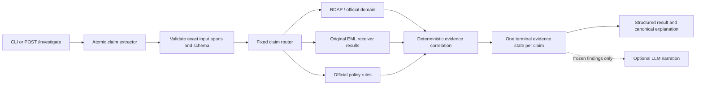

# Current flagship: regulated-investment clone firm — deterministic gate PASS

See [CLONE_FEASIBILITY.md](CLONE_FEASIBILITY.md). Run `python run_clone_feasibility.py`. Live LLM accuracy remains unmeasured until local API credentials are available.

The NVIDIA sections below are historical; that flagship has been stopped.

# Demo hardening status: FAIL

See [DEMO_HARDENING.md](DEMO_HARDENING.md) for current counts, raw run artifacts, live-extraction failures and rerun instructions.

# V1 impersonation investigation vertical slice

This package implements three verification primitives: RDAP/current registration metadata and official recruiting-domain comparison, receiver-reported SPF/DKIM/DMARC header interpretation, and deterministic published-policy/process checks. The prior organization/contact adapter is deliberately excluded from this engine.

Python 3.10+ and the standard library are sufficient. Run from `D:\8.Hackthon\forge-kill-tests`:

```powershell
python -m investigation demo --output results/nvidia-investigation.json
python -m unittest discover -s tests -v
```

The first command executes the full core flow and saves an API-shaped response. Omitting `--output` prints the entire response, including raw captured source evidence. The fixture is synthetic user input with four manually annotated critical claims; it does not pretend a model generated them. It uses genuine captured NVIDIA policy evidence, verifies its pinned SHA-256, and performs no network call. No RDAP response was captured for the contact domain, so that evidence remains unavailable rather than being fabricated.

## Architecture



The LLM can extract assertions and optionally narrate established findings. Extraction schemas contain no verdict/state/score fields. Extra fields, invalid spans, duplicate IDs and invented domain literals are rejected. The LLM never selects sources or invokes verification tools. Policy URLs, authority hosts, exact quotes and scope are backend configuration. Evidence states and correlation results are assigned only in deterministic Python.

The canonical explanation is assembled from deterministic findings. Optional LLM prose is returned as explicitly non-authoritative supplementary narration, never used to update claims or evidence. Invalid explanation references, detected probability estimates, and provider failures retain the canonical explanation and expose their errors. The provider receives copied finding summaries, not mutable engine results or raw policy pages.

## Files and reuse

| File | Responsibility |
|---|---|
| `investigation/models.py` | Four-state enum, immutable claim/evidence records, strict JSON and span validation |
| `investigation/llm.py` | Analyst/fixture annotations and real OpenAI Responses extraction/narration adapters |
| `investigation/verifiers.py` | Source capture integrity, curated policy/domain rules, RDAP and original-EML adapters |
| `investigation/engine.py` | Routing, failure-to-data-gap handling, correlation, response assembly |
| `investigation/api.py` | One stateless local JSON endpoint; original EML bytes arrive via base64 |
| `investigation/__main__.py` | `demo`, `investigate`, and `serve` commands |
| `fixtures/nvidia_recruiter/message.txt` | Synthetic recruiter message |
| `fixtures/nvidia_recruiter/claims.json` | Exact-span, hash-bound manual fixture annotations |
| `fixtures/nvidia_recruiter/request.json` | Ready-to-send annotated API request |
| `fixtures/nvidia_recruiter/policy_capture.json` | Genuine HTTPS response with source URL, date, status, headers, full body, exact bytes, quotes and hash |
| `tests/test_investigation.py` | Unit tests and actual local HTTP endpoint integration test |
| `results/nvidia-investigation.json` | Complete fixture investigation response |

The original feasibility scripts remain independently runnable. Domain normalization/comparison and live RDAP retrieval reuse `rdap_domain_provenance.py`; original-header parsing and receiver trust gates reuse `email_header_analysis.py`; curated-source HTTPS retrieval, redirect allowlisting, visible-text extraction and exact quote normalization reuse `scam_process_contradictions.py`. No original-probe behavior was changed for the MVP.

## First fixture: exact conclusions

Four critical assertions are preserved: affiliation, recruiting-domain association, equipment payment and reimbursement. Incidental selection, deadline and vendor descriptions are omitted, as is redundant official-communication status. Every claim receives exactly one of the four allowed evidence states, a verification scope/method, evidence references, findings and limitations.

One claim is contradicted by one underlying official-domain requirement: `nvidia-careers-team.com` is not either of the two email domains explicitly published for NVIDIA recruiting communications. The recruiting-domain claim conflicts with that scoped rule. Policy capture and derived comparison share one evidence_group_id; they do not count as independent findings.

The remaining three claims are unresolved. In particular, NVIDIA's source discusses upfront fees as a scam pattern but does not contain an explicit blanket no-equipment-fee rule. The engine preserves that raw warning and does not invent a prohibition, vendor fact or reimbursement verdict. Individual recruiter affiliation and job selection cannot be established by these three primitives.

Missing `.eml` and missing contact-domain RDAP data are reported as separate raw evidence gaps. Neither is treated as failed authentication or proof of fraud. A matching official domain and passing receiver-reported authentication still would not prove the person is NVIDIA's recruiter.

## Local API

One endpoint is exposed: `POST /investigate`. The server binds to `127.0.0.1`, keeps no database, and has no application authentication.

For an offline annotated fixture request:

```powershell
python -m investigation serve --source-mode snapshot --rdap-mode unavailable --allow-annotations
```

In another terminal:

```powershell
Invoke-RestMethod -Uri http://127.0.0.1:8000/investigate -Method Post -ContentType 'application/json; charset=utf-8' -InFile fixtures/nvidia_recruiter/request.json | ConvertTo-Json -Depth 50 | Set-Content results/nvidia-api-result.json -Encoding utf8
```

Annotating mode is explicit and disabled by default. The fixture `claims_annotation` is checked against the message hash and exact source spans. The normal endpoint uses real LLM extraction.

Request fields:

```json
{
  "message": "The text to investigate",
  "eml_base64": "optional original .eml file encoded as base64",
  "original_receiver_export": false
}
```

The optional `claims_annotation` field is accepted only with `--allow-annotations`. The API rejects filesystem paths, source overrides, state fields, malformed JSON, duplicate keys and invalid base64. It bounds message length, original EML bytes, request bytes and claim counts. It never fetches a supplied suspicious website URL; RDAP queries go to an IANA-discovered registry service.

Successful investigations return HTTP 200 even when facts remain unresolved or source requests failed: errors are retained as evidence. Invalid requests return 400/413/415; live LLM extraction failures return 502 with provider failure evidence. Unexpected server errors return 500. No substituted model or verifier response is silently used.

## Custom input and real LLM extraction

Set your API key and a model supporting Responses structured outputs in the terminal environment. The app never embeds a credential or guesses a model:

```powershell
$env:OPENAI_API_KEY = 'YOUR_REAL_KEY'
$env:OPENAI_MODEL = 'gpt-6.1-sol'
python -m investigation investigate --message-file your-message.txt --output results/custom-investigation.json
```

This uses live NVIDIA-policy retrieval and live RDAP by default. For custom analyst annotations without a model, supply `--claims-file your-annotations.json`; the JSON shape matches the fixture, with `origin` set to `analyst_annotation` and a message hash matching the exact UTF-8 text.

To use original receiver headers:

```powershell
python -m investigation investigate --message-file your-message.txt --eml your-original.eml --trusted-authserv-id YOUR_RECEIVER_ID --assert-original-receiver-export --output results/custom-investigation.json
```

Use the export assertion only for an original export from the independently configured receiver whose boundary strips forged Authentication-Results headers for its own ID. The script cannot independently prove export provenance. Server mode also supports `--trusted-authserv-id`; uploads supply `original_receiver_export` as an explicit provenance assertion. Authentication results remain receiver reports: there is no independent SPF DNS evaluation, DKIM signature validation or DMARC policy calculation.

Use `--llm-explanation` to add supplementary narration. A missing key/model or provider failure is exposed; the fixture and analyst extraction modes are named alternatives, never hidden fallbacks. No live LLM request was tested in this workspace because `OPENAI_API_KEY` was absent. Transport/validation failures and model-state injection were tested with labeled synthetic test doubles.

## Evidence and boundaries

The API response contains `claims`, `verification_method`/`verification_scope`, evidence references, raw evidence, source/provenance, evidence states, per-claim and overall limitations, contradiction summary, state counts and plain-language explanation. Evidence records include latency and explicit errors. There is no scam score or numerical probability.

Allowed terminal evidence states:

- `VERIFIED_BY_AUTHORITATIVE_SOURCE`
- `CONTRADICTED_BY_AUTHORITATIVE_SOURCE`
- `CONSISTENT_BUT_NOT_IDENTITY_PROVING`
- `NO_AUTHORITATIVE_DATA`

V1 policy/domain rules cover NVIDIA recruitment only. Other organizations and unsupported propositions remain unresolved. Exact matching accepts `nvidia.com` and `career.nvidia.com`, not arbitrary NVIDIA subdomains. A snapshot records what was published when captured, not a fresh policy check. Live HTTP errors, timeouts, malformed responses, missing quotes and truncation remain evidence gaps. There are no silent retries or source fallbacks.

RDAP supplies current registry metadata, not ownership continuity or a verification of arbitrary asserted registration dates. Receiver-header analysis has a conservative syntax subset and requires explicit receiver trust. No cryptographic binding between separately supplied message text and uploaded EML is claimed. Correlation preserves data gaps and leaves affiliation unresolved; ambiguous multiple contact domains cannot establish an unscoped communication claim.

The maintained source is [NVIDIA recruitment-scam guidance](https://www.nvidia.com/en-us/about-nvidia/careers/recruitment-scams/). The actual capture has its retrieval date and pinned digest in the fixture. The LLM transport follows [official OpenAI structured-output documentation](https://developers.openai.com/api/docs/guides/structured-outputs?api-mode=responses).
