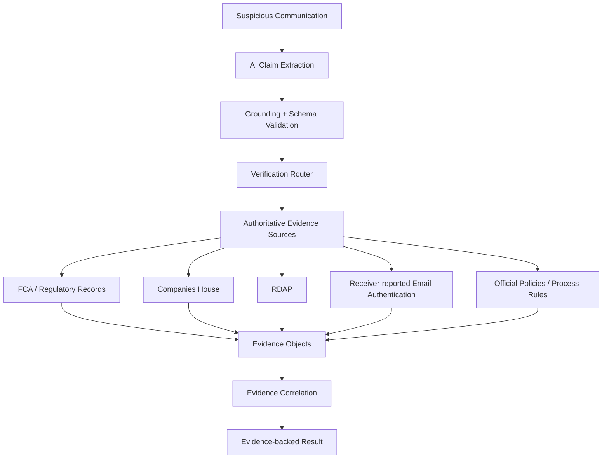

# CrossCheck

Evidence-backed impersonation investigation


> Real facts can still form a fake identity.

CrossCheck extracts factual claims from suspicious communication, grounds them in exact quotes, and checks them against public authoritative evidence. It shows which facts are supported, which relationships are contradicted, and what remains unknown—without an invented scam probability.

## Why We Built This

Impersonators can reuse a real company, registration number, executive name and legitimate branding, then substitute a fake website, phone, email, relationship or payment destination. A whole-message suspicious/not-suspicious verdict can miss this distinction.

**A real company and a real registration number do not prove that the person contacting you represents that company.** CrossCheck investigates individual claims and how they connect.

## Research → Product Insight

Scam detection landscape → human pain analysis → verification gap → authoritative evidence research → technical kill tests → CrossCheck architecture.

Our early fake NVIDIA recruiter scenario exposed an evidence boundary: the technical pipeline worked, but public records could not authenticate the human sender, and too many critical claims remained unresolved. We rejected it as the flagship rather than overstating the evidence.

We pivoted to regulated investment clone firms. The FCA's IPO Horizon / Horizon Financial Planning Limited warning lets us demonstrate a genuine company and regulatory reference alongside a contradicted relationship and contact channel.

**Fraud can be constructed from individually true facts connected by a false relationship.**

## Flagship Investigation

An illustrative communication claims that IPO Horizon represents Horizon Financial Planning Limited and supplies its website/contact as official.

| Claim | Result | Evidence |
|---|---|---|
| Horizon Financial Planning Limited is an active UK company | Verified | Companies House |
| The firm is FCA-authorised with FRN 307222 | Verified | FCA warning's genuine-firm record |
| IPO Horizon represents the authorised firm | Contradicted | FCA's explicit clone/no-connection warning |
| The supplied IPO Horizon website/contact belongs to the genuine firm | Contradicted | Exact comparison with FCA-published contacts |

Observed flagship result: **2 verified · 2 contradicted · 0 unresolved**. This is a measured result, not a forced output.

RDAP supplies independent domain provenance; it does not establish affiliation. Multiple FCA facts and their derived comparisons share one provenance group.

## How It Works



- **Extract:** the LLM understands unstructured text and proposes atomic claims, exact quotes and structured verification routes.
- **Ground and route:** code validates quotes/schema; exact regulator relationships can deterministically normalize affiliation routing.
- **Verify:** adapters retrieve evidence; code compares records and assigns states.
- **Correlate and explain:** preserve source groups, limitations and the distinction between genuine facts and sender identity.

Adapters have different scopes; the clone-firm flagship does not use email authentication or policy checks.

| Canonical evidence state | Human meaning |
|---|---|
| `VERIFIED_BY_AUTHORITATIVE_SOURCE` | The source supports the specific fact within its stated scope. |
| `CONTRADICTED_BY_AUTHORITATIVE_SOURCE` | The source explicitly conflicts with the claim. |
| `CONSISTENT_BUT_NOT_IDENTITY_PROVING` | The fact matches, but does not authenticate the contacting party. |
| `NO_AUTHORITATIVE_DATA` | Usable authoritative evidence is unavailable or insufficient. |

## Why This Is More Than an LLM Wrapper

Typical approach: message → LLM → “82% scam”.

CrossCheck: message → grounded claims → verification routes → authoritative evidence → deterministic states → explanation.

**The LLM cannot mark a claim VERIFIED or CONTRADICTED.** Evidence-state assignment happens outside the model. Exact-quote validation and deterministic verification reduce opportunities for suspicious text to instruct itself into being verified; they do not completely solve prompt injection.

## Evidence Sources

| Adapter | Current scope and boundary |
|---|---|
| Financial Conduct Authority | Curated clone warning, genuine firm's identity/FRN, and contact/relationship comparisons—not a universal live permissions lookup. |
| Companies House | Named legal entity and active status; existence does not authenticate a sender. |
| RDAP | Domain registration and infrastructure metadata; no proof of personal identity or sender legitimacy. |
| Email authentication | Receiver-reported SPF/DKIM/DMARC parsing from original exports; no complete independent cryptographic DKIM verification. |
| Official policies/process rules | Explicitly encoded contradictions where authoritative policy evidence and applicable scope exist; no universal policy coverage. |

## Tech Stack

| Layer | Technology | Purpose |
|---|---|---|
| AI extraction | OpenAI Responses API | Structured atomic claims and proposed routes |
| Backend | Python standard library | Evidence adapters, verification and correlation |
| Frontend | React + TypeScript | Typed investigation interface |
| Build | Vite | Development and production assets |
| Testing | Python unittest; Vitest + Testing Library | Regression and UI checks |
| Evidence | FCA, Companies House, RDAP, official sources | Deterministic verification |

## Project Structure

```text
CrossCheck/
├── investigation/          # Engine and evidence adapters
├── tests/                  # Python regression tests
├── fixtures/               # Labelled synthetic inputs and captured public evidence
├── web/                    # React + TypeScript interface and UI tests
├── results/                # Validation outputs
├── check_product_live.py   # Actual-provider release check
├── run_product.py          # Local product launcher
└── README.md
```

## Validation

Recorded checks: **87 Python regression tests passed**, **13 frontend tests passed**, lint passed, production build passed.

The [five consecutive live flagship runs](results/live-flagship-five-runs.json) each returned HTTP 200, executed the real model, and produced four claims: two verified, two contradicted, zero unresolved. Observed end-to-end latencies were **10.07s, 8.63s, 5.50s, 8.04s and 5.32s**: approximately **5.32–10.07 seconds**.

Counts are backend-derived, not hard-coded. No fabricated evidence or silent fixture fallback was used.

**Prototype validation benchmark—not production accuracy.** The [12-case extraction benchmark](results/extraction-benchmark-optimized.md) recorded 12/12 successful responses, 15/15 expected critical claims recalled, zero unsupported/hallucinated claims, 100% schema-valid output and zero invalid routes. This bounded corpus does not establish general accuracy or availability.

## Safety Boundaries

Company existence, regulatory registration and a registered domain do not authenticate the person contacting you. Receiver-reported SPF/DKIM/DMARC results do not establish human trustworthiness. Missing public evidence is not automatically fraud; sources can fail or be jurisdiction-limited.

**Unknown is a valid result.** `NO_AUTHORITATIVE_DATA` preserves a gap rather than converting uncertainty into a contradiction.

## Run Locally

Requirements: Python 3.10+, Node.js/npm compatible with Vite 7, an OpenAI API key and internet access.

```bash
git clone https://github.com/Siteshcodes/CrossCheck.git
cd CrossCheck
```

Create a private `.env` in the repository root:

```dotenv
OPENAI_API_KEY=your_openai_api_key_here
OPENAI_MODEL=gpt-6.1-sol
```

Never commit the key or put it in `VITE_OPENAI_API_KEY` or another frontend-exposed variable.

```bash
cd web
npm ci
npm run build
cd ..
python run_product.py
```

Open **http://127.0.0.1:8080** and select **Load flagship example →** or paste your own communication. Default mode uses live extraction. Missing keys and provider failures fail closed; annotated extraction requires an explicit, labelled test mode.

## Testing

```bash
python -m unittest discover -s tests -v
npm --prefix web test
npm --prefix web run lint
npm --prefix web run build
python check_product_live.py
```

The live release check requires an API key and internet access. It submits flagship and manual text without fixture annotations; it is separate from offline regression tests.

## Limitations

This prototype has limited, jurisdiction-specific authoritative adapters, source availability/rate-limit dependencies and explicit email evidence boundaries. It offers no universal human identity proof. Some claims will remain unresolved.

## Future Work

Additional regulatory jurisdictions and authoritative adapters; independent DNS/DKIM checks; multi-channel email/SMS/call/web correlation; browser/email integrations. These are planned directions, not current capabilities.

## Research & Technical Validation

Supporting research: [Feasibility report](FEASIBILITY_REPORT.md), [clone-firm feasibility](CLONE_FEASIBILITY.md), [demo hardening](DEMO_HARDENING.md), and [MVP validation](MVP_VALIDATION.md). Earlier scenario reports document experiments, not the final flagship.

## Hackathon

Built for **ForgeHacks Online 2026**, **Cybersecurity** track. CrossCheck focuses on the “verify” part of preventing scams and impersonation.

> AI decides what needs investigation. Evidence decides what is true.

## Demo

Demo video: Coming soon  
Live demo: Coming soon
